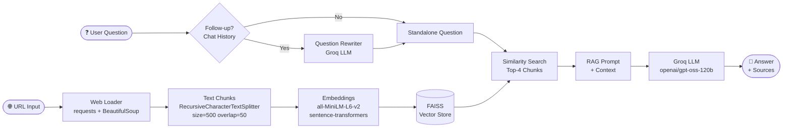

# 🔍 Web RAG Chatbot

A Retrieval-Augmented Generation (RAG) chatbot that loads any webpage, indexes its content, and answers questions grounded strictly in that page — with source citations and follow-up question support.

Built over 7 days as a structured learning project: ingestion → retrieval → UI → evaluation → API → deployment.

---

## Architecture



---

## Tech Stack

| Layer | Technology |
|---|---|
| Web scraping | `requests`, `BeautifulSoup4` |
| Text splitting | `langchain-text-splitters` — RecursiveCharacterTextSplitter |
| Embeddings | `sentence-transformers` — `all-MiniLM-L6-v2` (local, no API) |
| Vector store | `FAISS` (in-memory) |
| LLM | Groq API — `openai/gpt-oss-120b` |
| Orchestration | `LangChain` (core + community + groq) |
| UI | `Streamlit` |
| API | `FastAPI` + `Uvicorn` |
| Containerization | `Docker` (python:3.11-slim) |

---

## Project Structure

```
doc_bot/
├── ingestion/
│   ├── web_loader.py       # URL load, clean, chunk
│   └── vectorstore.py      # FAISS index build
├── retrieval/
│   └── rag.py              # Question rewrite + RAG answer
├── app/
│   └── streamlit_app.py    # Streamlit chat UI
├── api/
│   └── main.py             # FastAPI REST API
├── evaluation/
│   ├── questions.md        # 15 test cases
│   ├── run_eval.py         # Eval runner → CSV
│   └── eval_results_*.csv  # Results
├── Dockerfile
├── requirements.txt
└── .env                    # GROQ_API_KEY
```

---

## Setup

### Prerequisites
- Python 3.11+
- Groq API key — [console.groq.com](https://console.groq.com)

### Installation

```bash
git clone https://github.com/your-username/doc-bot.git
cd doc-bot

pip install -r requirements.txt
```

### Configuration

```bash
# .env file create பண்ணுங்க
echo GROQ_API_KEY=your_key_here > .env
```

### Run — Streamlit UI

```bash
streamlit run app/streamlit_app.py
```

Open: http://localhost:8501

### Run — FastAPI

```bash
uvicorn api.main:app --reload
```

Open: http://localhost:8000/docs

**API usage:**

```bash
# Step 1: Index a URL
curl -X POST http://localhost:8000/index \
  -H "Content-Type: application/json" \
  -d '{"url": "https://docs.python.org/3/tutorial/introduction.html"}'

# Step 2: Ask a question
curl -X POST http://localhost:8000/ask \
  -H "Content-Type: application/json" \
  -d '{"url": "https://docs.python.org/3/tutorial/introduction.html", "question": "What is a list in Python?"}'
```

### Run — Docker

```bash
# Build
docker build -t web-rag-api .

# Run (API key runtime-ல் inject பண்றோம்)
docker run -p 8000:8000 -e GROQ_API_KEY=your_key_here web-rag-api
```

---

## Evaluation Results

Evaluated on: `https://docs.python.org/3/tutorial/introduction.html`
Test cases: **15** | Model: `openai/gpt-oss-120b`

| Category | Questions | Correct | Accuracy |
|---|---|---|---|
| Direct (clear facts) | 5 | 4 | 80% |
| Detailed (specific facts) | 3 | 2 | 67% |
| Not-in-page (should refuse) | 3 | 3 | **100%** |
| Follow-up base | 2 | 2 | **100%** |
| Follow-up (pronoun resolution) | 2 | 2 | **100%** |
| **Overall Answer Accuracy** | **15** | **13** | **86.7%** |
| **Source Accuracy** | **15** | **15** | **100%** |

**Key observations:**
- Not-in-page refusal: 100% — LLM correctly said "இந்த website-ல் அந்த தகவல் இல்லை" for out-of-scope questions
- Source accuracy: 100% — every retrieved chunk came from the correct URL
- 2 failures were keyword-matching false negatives (LLM answered correctly in different phrasing)
- Follow-up pronoun resolution ("them" → "strings", "its" → "list") worked perfectly

---

## Limitations

| Limitation | Detail |
|---|---|
| **Single page only** | One URL per session — multi-URL RAG not supported |
| **JS-heavy sites** | Sites that render content via JavaScript (SPAs, React apps) will return empty or partial text — `requests` fetches raw HTML only |
| **In-memory index** | FAISS index lives in RAM — server restart or Docker container stop wipes all indexes |
| **No auth** | FastAPI has no authentication — not production-ready as-is |
| **Sync indexing** | `/index` endpoint blocks until embedding is done — large pages may timeout |
| **Single worker** | Docker runs 1 Uvicorn worker — in-memory index won't share across multiple workers |

---

## Future Improvements

- [ ] **Multi-URL support** — index multiple pages, merge FAISS indexes
- [ ] **Playwright/Selenium loader** — handle JS-rendered pages (SPAs, dynamic content)
- [ ] **Persistent index** — `FAISS.save_local()` to disk or cloud storage (S3)
- [ ] **Streaming responses** — LLM token streaming via `StreamingResponse` in FastAPI
- [ ] **Reranking** — add a cross-encoder reranker after FAISS retrieval for better precision
- [ ] **Confidence score** — return similarity scores alongside sources
- [ ] **PDF / DOCX support** — extend ingestion beyond web pages
- [ ] **API authentication** — add API key middleware for production use
- [ ] **Async indexing** — background task queue (Celery / FastAPI BackgroundTasks)
- [ ] **Evaluation automation** — hook `run_eval.py` into CI/CD pipeline

---

## Deployment — HuggingFace Spaces (Streamlit)

See [Deployment Guide](#huggingface-spaces-deployment) below.

---

## HuggingFace Spaces Deployment

### Step 1 — Spaces-compatible `app.py`

HuggingFace Spaces expects the entry file at root as `app.py`:

```bash
copy app\streamlit_app.py app.py
```

### Step 2 — Create `packages.txt` (system deps for FAISS)

```
libgomp1
```

### Step 3 — Push to HuggingFace

```bash
# HuggingFace CLI install
pip install huggingface_hub

# Login
huggingface-cli login

# New Space create (Streamlit SDK)
huggingface-cli repo create web-rag-chatbot --type space --space_sdk streamlit

# Git setup
git init
git remote add origin https://huggingface.co/spaces/your-username/web-rag-chatbot

git add app.py requirements.txt packages.txt
git commit -m "Initial deploy"
git push origin main
```

### Step 4 — Set GROQ_API_KEY secret

HuggingFace Space settings → **Variables and Secrets** → Add secret:
- Name: `GROQ_API_KEY`
- Value: `gsk_...`

> ⚠️ Never commit `.env` to the repo — use HF Secrets only.

### Step 5 — Verify

Space URL: `https://huggingface.co/spaces/your-username/web-rag-chatbot`

Build logs: Space → **Logs tab** → watch for `[INFO] LLM initialized` or embedding model download.

### Notes on HF Spaces free tier

| Resource | Free tier limit |
|---|---|
| RAM | 16 GB |
| CPU | 2 vCPU |
| Storage | Ephemeral — index lost on restart |
| `all-MiniLM-L6-v2` download | ~90 MB — cached after first boot |
| Cold start | ~60–90s (model download on first run) |
