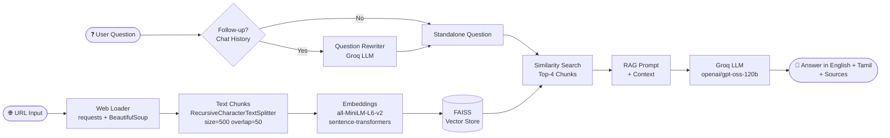

# 🔍 Web RAG Chatbot

A Retrieval-Augmented Generation (RAG) chatbot that loads any webpage, indexes its content, and answers questions grounded strictly in that page — with source citations and follow-up question support. Answers are provided in both **English and Tamil**.

🚀 **Live Demo:** [docbot-ukx6jblyu2bbzvkdkkivty.streamlit.app](https://docbot-ukx6jblyu2bbzvkdkkivty.streamlit.app)

---

## Architecture



---

## Features

- 🌐 Load any public webpage and ask questions about it
- 💬 Answers in both **English and Tamil**
- 🔄 Follow-up question support with pronoun resolution
- 📚 Source citations for every answer
- 🚫 Refuses to answer questions not found in the page

---

## Tech Stack

| Layer | Technology |
|---|---|
| Web scraping | `requests`, `BeautifulSoup4` |
| Text splitting | `langchain-text-splitters` — RecursiveCharacterTextSplitter |
| Embeddings | `sentence-transformers` — `all-MiniLM-L6-v2` (local, no API) |
| Vector store | `FAISS` (in-memory) |
| LLM | Groq API — `openai/gpt-oss-120b` |
| Orchestration | `LangChain` (core + community + groq) |
| UI | `Streamlit` |
| Deployment | Streamlit Cloud |

---

## Project Structure

```
doc_bot/
├── ingestion/
│   ├── web_loader.py       # URL load, clean, chunk
│   └── vectorstore.py      # FAISS index build
├── retrieval/
│   └── rag.py              # Question rewrite + RAG answer
├── app/
│   └── streamlit_app.py    # Streamlit chat UI
├── evaluation/
│   ├── questions.md        # 15 test cases
│   └── run_eval.py         # Eval runner
├── requirements.txt
├── runtime.txt             # Python 3.11
└── .env                    # GROQ_API_KEY (never committed)
```

---

## Local Setup

### Prerequisites
- Python 3.11+
- Groq API key — [console.groq.com](https://console.groq.com)

### Installation

```bash
git clone https://github.com/ABINAYAKRISHNA0802/doc_bot.git
cd doc_bot

pip install -r requirements.txt
```

### Configuration

Create a `.env` file:
```
GROQ_API_KEY=your_key_here
```

### Run

```bash
streamlit run app/streamlit_app.py
```

Open: http://localhost:8501

---

## Evaluation Results

Evaluated on: `https://docs.python.org/3/tutorial/introduction.html`
Test cases: **15** | Model: `openai/gpt-oss-120b`

| Category | Questions | Correct | Accuracy |
|---|---|---|---|
| Direct (clear facts) | 5 | 4 | 80% |
| Detailed (specific facts) | 3 | 2 | 67% |
| Not-in-page (should refuse) | 3 | 3 | **100%** |
| Follow-up base | 2 | 2 | **100%** |
| Follow-up (pronoun resolution) | 2 | 2 | **100%** |
| **Overall** | **15** | **13** | **86.7%** |
| **Source Accuracy** | **15** | **15** | **100%** |

---

## Limitations

| Limitation | Detail |
|---|---|
| Single page only | One URL per session |
| JS-heavy sites | Dynamic/SPA pages may return empty content |
| In-memory index | Index lost on app restart |

---

## Future Improvements

- [ ] Multi-URL support
- [ ] Playwright loader for JS-rendered pages
- [ ] Persistent FAISS index
- [ ] PDF / DOCX ingestion
- [ ] Streaming responses
- [ ] Reranking with cross-encoder
